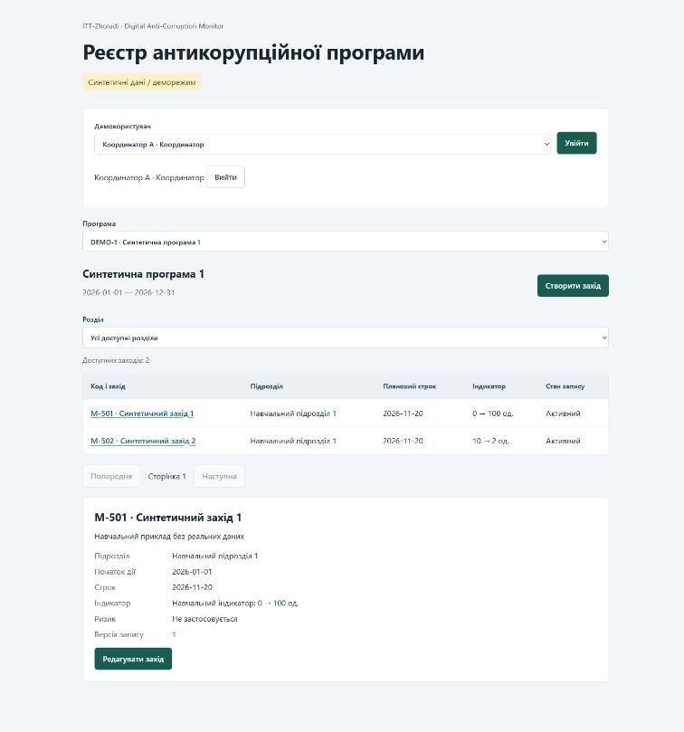

# Digital Anti-Corruption Monitor

Команда **ITT-Zholudi (K31)** · [Завдання 2. Моніторинг виконання антикорупційної програми](https://hack.bitec.com.ua/zavdannia-2/)

Координатор веде заходи, строки, відповідальних та індикатори в одному реєстрі. Виконавець бачить призначені йому заходи. Зміни реєстру фіксуються в журналі аудиту.

## Що можна перевірити

- Увійти як **Координатор А**, переглянути реєстр, відфільтрувати заходи за розділом, відкрити картку, створити чи відредагувати захід.
- Увійти як **Виконавець А** або **Виконавець Б** і побачити різні списки призначених заходів.
- Імпортувати синтетичний пакет у внутрішньому JSON-форматі через API від імені демоадміністратора. Прямий імпорт офіційних CSV, JSON і XLSX ще не реалізовано. [Карта відповідності](docs/official-dataset-mapping.md)



Етапи 0 і 1 на публічному рев’ю. Подання результатів і погодження, сигнали, панелі, звіт та відео заплановані далі. [Поточний стан](docs/PROGRESS.md) · [План етапів](docs/PROJECT_STAGES.md)

## Як запустити

Потрібні Git, Node.js 24 і npm. До злиття публічного PR після клонування виконайте `git switch codex/stage-01-registry`. Після злиття достатньо клонувати основну гілку.

```bash
git clone https://github.com/Hulkovskyi/bitec-hackathon-2026.git && cd bitec-hackathon-2026
npm ci
npm run build
DEMO_MODE=true npm run seed
DEMO_MODE=true npm start
```

У PowerShell виконайте `$env:DEMO_MODE = "true"` перед `npm run seed` та `npm start`. Відкрийте <http://127.0.0.1:3001>. Для автоматичної перевірки запустіть `npm test`.

## Як влаштовано

| Стек | Шлях |
| --- | --- |
| React і Vite | [apps/web](apps/web/) |
| Node.js 24, Express і SQLite | [apps/api](apps/api/) |
| GitHub Actions | [.github/workflows/ci.yml](.github/workflows/ci.yml) |

Реєстр працює локально без ШІ-сервісу. ChatGPT і Codex використовували під час планування, розробки та перевірки. [Архітектура](docs/architecture.md) · [Використання ШІ](docs/ai.md)

## Документація та подання

- [Контракт реєстру](docs/registry-contract.md) і [відтворення сценарію](docs/registry.md)
- [Контракт наступних етапів](docs/workflow-contract.md)
- [Вимоги організаторів](docs/REQUIREMENTS.md) і [записи етапів](docs/stages/)
- За повідомленням учасника команди, URL репозиторію подано організаторам. Код для оцінювання має бути в `main` до 20.11, 23:59, документація й відео до 23.11, 10:00 за Києвом. [Правила подання](https://hack.bitec.com.ua/podannia/)

Ліцензія [MIT](LICENSE).
