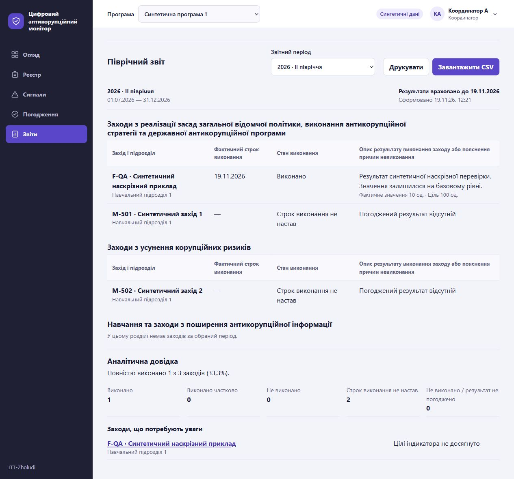

# Digital Anti-Corruption Monitor

Команда **ITT-Zholudi (K31)** · [Завдання 2. Моніторинг виконання антикорупційної програми](https://hack.bitec.com.ua/zavdannia-2/)

## Проблема і користувач

Координатор антикорупційної програми збирає від підрозділів строки, результати й підтвердні матеріали. Коли вони розпорошені між таблицями та листуванням, складно звірити статуси й відтворити історію погодження. Виконавцю потрібен список власних завдань, а керівнику — огляд відхилень із переходом до конкретних записів. Застосунок веде цей процес від призначення заходу до піврічного звіту.

## Що робить рішення

- Веде програму, розділи, заходи, строки, виконавців та індикатори в одному реєстрі.
- Дає виконавцю подати результат із доказом, а координатору — повернути з коментарем або погодити. Версії доказів, SHA‑256 і дії доступні в історії.
- Показує рольові панелі й сигнали строків, браку доказів та відхилень від цілей із переходом до джерела.
- Формує піврічний звіт, друковану форму, CSV та аналітичну довідку з погоджених результатів і реєстру.
- Приймає синтетичний імпорт у [внутрішньому JSON-форматі](docs/registry-contract.md). Для форматів організаторів підготовлено [карту полів](docs/official-dataset-mapping.md).



## Демонстрація

[Відкрити BITEC у браузері](https://bitec-hackathon-2026.vercel.app). Оберіть **Координатор А** для дашборда й звіту або **Виконавець А** для роботи з результатом. Демо використовує спільні синтетичні дані. Для повного циклу погодження з чистими даними скористайтеся локальним запуском.

Публічне посилання на демонстраційне відео очікується. [Сценарій відео до 3 хвилин](docs/demo-video.md)

## Як запустити

Потрібні Git, Node.js 24 і npm. Клонуйте основну гілку репозиторію. Локальний запуск використовує SQLite та синтетичні демодані.

```bash
git clone https://github.com/Hulkovskyi/bitec-hackathon-2026.git && cd bitec-hackathon-2026
npm ci
npm run build
DEMO_MODE=true npm run seed
DEMO_MODE=true npm start
```

У PowerShell виконайте `$env:DEMO_MODE = "true"` перед `npm run seed` та `npm start`. Відкрийте <http://127.0.0.1:3001>. Для автоматичної перевірки запустіть `npm test`.

## Як влаштовано

| Стек | Шлях |
| --- | --- |
| React і Vite | [apps/web](apps/web/) |
| Node.js 24, Express і локальна SQLite | [apps/api](apps/api/) |
| Vercel Hobby, Supabase Free і PostgreSQL | [Онлайн-розгортання](docs/deployment.md) |
| GitHub Actions | [.github/workflows/ci.yml](.github/workflows/ci.yml) |

Правила строків і Risk Flags використовують дати, статуси, докази й значення індикаторів. Сигнал показує причину та пропонує дію. Результат погоджує координатор. [Схема компонентів](docs/architecture.md) · [Правила й API](docs/analytics.md) · [Змінні оточення](.env.example)

## Документація

| Матеріал | Що містить |
| --- | --- |
| [Архітектура](docs/architecture.md) | Компоненти, потік даних і доступ у локальному та хмарному режимах. |
| [Наскрізний сценарій](docs/verification.md) | Від призначення заходу до погодження, сигналів і звіту. |
| [Рольові панелі](docs/analytics.md#приклади-рольових-панелей) | Приклади кабінетів виконавця, координатора й керівника. |
| [Звітність](docs/reporting.md) | Правила вибірки й синтетичні зразки [PDF A4](docs/examples/half-year-2026-H2-a4.pdf), [CSV](docs/examples/half-year-2026-H2.csv) і [довідки](docs/examples/half-year-2026-H2-brief.md). |
| [Економія часу](docs/measurements.md) | Методика парних замірів для трьох ролей і стан вимірювань. |
| [Карта інтеграцій](docs/integrations.md) | Поточний API й можливі напрями обміну з системами МОУ та НАЗК. |
| [Аналіз зловживань](docs/security.md) | Сценарії, запобіжники й результати перевірок. |
| [Як ми використали ШІ](docs/ai.md) | Інструменти, рішення команди й перевірка результатів. |
| [Матеріали подання](docs/submission.md) | Перевірений коміт коду, докази та стан комплекту. |

## Що використали

- React і Vite для вебінтерфейсу, Express і Busboy для API та завантаження доказів, SQLite і драйвер `pg` для даних. [Версії залежностей](package-lock.json)
- Vercel Hobby і Supabase Free для онлайн-демо. [Розгортання](docs/deployment.md)
- Синтетичний набір BITEC для звірки моделі, полів звіту й окремого прикладу. [Карта відповідності](docs/official-dataset-mapping.md)
- ChatGPT, Codex і ImageGen для роботи команди над вимогами, кодом, тестами й ескізами. [Записка про ШІ](docs/ai.md)

Ліцензія [MIT](LICENSE).
