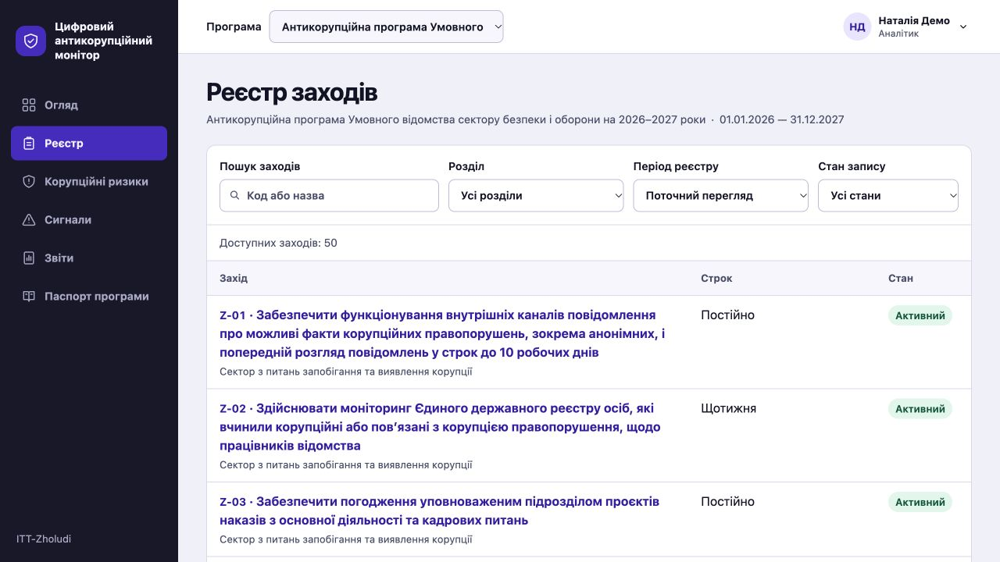

# Digital Anti-Corruption Monitor

**ITT-Zholudi (K31)** · BITEC Hackathon 2026 · [Завдання 2](https://hack.bitec.com.ua/zavdannia-2/)

## Проблема і користувач

Коли заходи, строки й докази ведуть у різних таблицях і листуванні, координатору складно зібрати перевірений звіт. Виконавець подає результат і підтвердження в картці свого заходу, а координатор погоджує їх або повертає з коментарем. Керівник і аналітик бачать прогрес та можуть перейти від сигналу чи рядка звіту до відповідного заходу.

## Що робить рішення

- Веде паспорт програми, підрозділи, заходи, корупційні ризики та їхні індикатори.
- Зберігає результати, версії підтвердних файлів і журнал дій. Перевіряє цілісність файлів за SHA-256.
- Показує рольові дашборди, нагадування про строки й сигнали ризику з поясненнями.
- Формує піврічний звіт, аналітичну довідку, CSV і друковану форму A4.
- Обмежує доступ за роллю, підрозділом і призначенням виконавця.



## Демонстрація

**[Відкрити онлайн-демо](https://bitec-hackathon-2026.vercel.app/)**. Доступ надає адміністратор. Для перегляду реєстру, сигналів і звітів використайте роль аналітика.

На синтетичних даних організаторів доступні 50 заходів, 14 ризиків, звіт за І півріччя 2026 року й 29 контрольних сигналів. [Сценарій перевірки](docs/verification.md)

Посилання на відео до 3 хвилин ще не додано. [Сценарій відео](docs/demo-video.md)

## Як запустити

Потрібні Git, Node.js 24 і npm. Після встановлення залежностей застосунок працює локально зі SQLite без доступу до інтернету.

1. Клонуйте репозиторій і відкрийте його папку.
   ```bash
   git clone https://github.com/Hulkovskyi/bitec-hackathon-2026.git
   cd bitec-hackathon-2026
   ```
2. Виконайте `npm ci` і `npm run build`.
3. Для навчальної бази виконайте `DEMO_MODE=true npm run seed` або [імпортуйте офіційний набір](#локальне-демо-на-офіційному-наборі-bitec). У PowerShell встановіть `$env:DEMO_MODE = 'true'` перед `npm run seed`.
4. [Створіть першого адміністратора](#вхід-з-обліковими-записами) в тій самій базі.
5. Виконайте `npm start`, відкрийте <http://127.0.0.1:3001> й увійдіть з обраним логіном і паролем.

Автоматичні перевірки запускаються командою `npm test`.

### Вхід з обліковими записами

За замовчуванням використовується `data/demo.sqlite`. Якщо під час імпорту вказали `DATABASE_PATH`, збережіть те саме значення для `create-admin` і `npm start`.

<details>
<summary>Команди для Bash і Zsh</summary>

```bash
(
  export DACM_ADMIN_USERNAME=team-admin
  export DACM_ADMIN_NAME='Адміністратор демо'
  export DACM_ADMIN_DEPARTMENT='Команда BITEC'
  export DACM_ADMIN_POSITION='Адміністратор'
  printf 'Пароль адміністратора (від 6 символів): '
  read -rs DACM_ADMIN_PASSWORD
  printf '\n'
  export DACM_ADMIN_PASSWORD
  npm run create-admin
)
```

</details>

<details>
<summary>Команди для PowerShell 7</summary>

```powershell
$env:DACM_ADMIN_USERNAME = 'team-admin'
$env:DACM_ADMIN_NAME = 'Адміністратор демо'
$env:DACM_ADMIN_DEPARTMENT = 'Команда BITEC'
$env:DACM_ADMIN_POSITION = 'Адміністратор'
$env:DACM_ADMIN_PASSWORD = Read-Host 'Пароль адміністратора (від 6 символів)' -MaskInput
try { npm run create-admin } finally { Remove-Item Env:DACM_ADMIN_PASSWORD }
```

</details>

### Локальне демо на офіційному наборі BITEC

Після `npm ci` розпакуйте `dani/nabir.json` і `kliuch/ochikuvani-sygnaly.csv` з архіву організаторів. Скрипт імпортує його в окремий файл SQLite і з параметром `--verify` запускає тимчасовий локальний API для звірки. [Синтетичний ZIP BITEC](https://hack.bitec.com.ua/wp-content/uploads/2026/11/zavdannia-2-syntetychnyi-nabir-63022726.zip)

**PowerShell**

```powershell
$env:DEMO_MODE = 'true'
$env:DATABASE_PATH = './data/official-bitec.sqlite'
node scripts/import-official-dataset.mjs 'C:\шлях\до\dani\nabir.json' $env:DATABASE_PATH --verify --risk-key 'C:\шлях\до\kliuch\ochikuvani-sygnaly.csv'
```

**Bash або Zsh**

```bash
export DEMO_MODE=true
export DATABASE_PATH=./data/official-bitec.sqlite
node scripts/import-official-dataset.mjs '/шлях/до/dani/nabir.json' "$DATABASE_PATH" --verify --risk-key '/шлях/до/kliuch/ochikuvani-sygnaly.csv'
```

Очікуваний результат звірки містить `rows: 50`, `referenceRows: 50` і `differences: []`. Для сигналів очікуються `expected: 29`, `observed: 29`, `matched: 29` та порожні списки розбіжностей. Щоб переглянути імпортовану програму в браузері, створіть першого адміністратора в тому самому `DATABASE_PATH`, запустіть застосунок і відкрийте **Звіти → 2026 · І півріччя** або **Сигнали → Зріз організаторів**.

## Як влаштовано

Інтерфейс на React і Vite звертається до API на Node.js 24 та Express. API перевіряє доступ, записує зміни й аудит та обчислює сигнали за явними правилами. Локальний запуск використовує SQLite, онлайн-версія працює на Vercel і Supabase PostgreSQL. [Інтерфейс](apps/web/) · [API](apps/api/) · [Архітектура](docs/architecture.md) · [Розгортання](docs/deployment.md)

## Документація

- [Результати й погодження](docs/workflow.md) · [Правила сигналів і дашборди](docs/analytics.md) · [Звітність](docs/reporting.md)
- [Приклад звіту A4](docs/examples/half-year-2026-H2-a4.pdf), [CSV](docs/examples/half-year-2026-H2.csv) й [аналітична довідка](docs/examples/half-year-2026-H2-brief.md)
- [Карта інтеграцій із МОУ та НАЗК](docs/integrations.md) · [Аналіз зловживань і запобіжники](docs/security.md) · [Методика замірів економії часу](docs/measurements.md)
- [Матеріали подання](docs/submission.md) · [Вимоги завдання](docs/REQUIREMENTS.md)

## Що використали

React, Vite, Express, Busboy, `pg` та синтетичний набір BITEC. ChatGPT і Codex допомагали з розробкою та перевіркою, ImageGen — з ескізами інтерфейсу. [Залежності](package-lock.json) · [Як ми використали ШІ](docs/ai.md) · [Ліцензія MIT](LICENSE)
