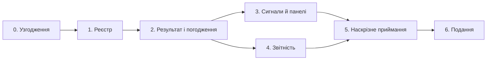

# Етапи розробки й оформлення основного репозиторію

Цей репозиторій — публічне джерело кінцевого продукту та матеріалів подання команди ITT-Zholudi для завдання №2. Робоча реалізація ведеться в приватній чернетці `StaS228-M/digital-anti-corruption-monitor` (Issues #1–#5). Посилання на приватні PR допомагають команді координуватися, але не замінюють код, інструкції та докази в цьому репозиторії: сторонній читач не має доступу до чернетки. Офіційні вимоги й відповідність етапам зібрані в [REQUIREMENTS.md](REQUIREMENTS.md).

План описує **порядок і критерії**, а не заявляє, що функції вже готові. Поточний стан ведеться в [PROGRESS.md](PROGRESS.md). Кожен завершений етап отримує окремий запис за [шаблоном](STAGE_RECORD_TEMPLATE.md).

## Офіційні часові межі

За [правилами подання IV Хакатону](https://hack.bitec.com.ua/podannia/) (перевірено 18.11.2026; час — Київ):

| Рубіж | Що має бути в основному репозиторії |
| --- | --- |
| 18.11, 10:00 | Капітан подає URL цього публічного репозиторію через форму. Учасник команди підтвердив у чаті, що посилання подано; час і квитанція тут не зафіксовані. |
| 20.11, 23:59 | Останній push **коду в `main`**, який врахує журі. Готовність у приватній чернетці або відкритий PR не зараховуються. |
| 21.11, ранок | Очікується звіт автоматичної перевірки організаторів; зафіксувати його зауваження й дозволені виправлення. |
| 23.11, 10:00 | Кінець доповнення `README.md`, `LICENSE`, `.env.example`, `docs/`, `presentation/` та відео. Після строку коду не планувати змін, від яких залежить оцінка: пізні зміни коду не врахують. |

Відео до трьох хвилин має показувати роботу рішення й відкриватися за посиланням у README без входу в командний акаунт. `docs/ai.md` обов'язковий і має вміститися в одну сторінку. `presentation/` із PDF потрібна лише номінантам до 26.11, 18:00. Репозиторій залишається публічним щонайменше до 31.12.2026; комітять лише акаунти учасників, указані у формі.

## Правило завершення етапу

Етап вважається завершеним лише коли:

1. Критерії пов'язаного Issue виконані в чернетці, останній commit перевірив інший учасник, а залежний PR прийнятий. Для етапів без окремого Issue команда фіксує критерії в PR.
2. У **цьому** репозиторії окремим PR з'явилися прийняті код і потрібні документи. У PR вказано вихідний commit/PR чернетки, перенесені шляхи та відмінності між репозиторіями. Чернеткові файли не копіюються без перевірки їхнього змісту.
3. На чистій копії основного репозиторію виконано наведені в README команди, автоматичні перевірки та відповідний браузерний сценарій. Результати й обмеження записані в `docs/stages/NN-*.md`; зелений CI чернетки не підміняє перевірку основного репозиторію.
4. Оновлено `README.md`, [PROGRESS.md](PROGRESS.md), відповідні доменні документи з таблиці нижче та `docs/ai.md`. Документи описують **фактично наявне** в `main`; заплановане й неперевірене позначено прямо.
5. Публічний PR пройшов незалежне рев'ю й злитий у `main`. До цього стан етапу — «на перевірці», навіть якщо код працює локально.

Після кожного етапу в записі вказують відповідального, дату, SHA публічного commit, джерело в чернетці, команди й результати тестів, демодані, посилання на знімки/зразки, відомі межі та наступного виконавця. У Git потрапляють лише синтетичні дані й безпечні приклади; паролі, токени, реальні матеріали та локальна SQLite-база не публікуються.

## Залежності

Після етапу 2 роботу над 3 і 4 можна вести паралельно в окремих PR, якщо обидва спираються на один прийнятий контракт результатів. Публікувати їх як завершені слід окремо; етап 5 збирає їх в один перевірений сценарій.

## 0. Узгодження продукту, контракту та двох репозиторіїв

**Вхід:** публічна заготовка й погоджені контракти чернетки (PR #6 вже злитий у її `main`).

**Робота:** звірити реалізацію з [офіційним завданням №2](https://hack.bitec.com.ua/zavdannia-2/) та його [синтетичним набором](https://hack.bitec.com.ua/wp-content/uploads/2026/11/zavdannia-2-syntetychnyi-nabir-63022726.zip), включно зі словником, навмисними кейсами та еталонним звітом; визначити одну публічну назву (ACCC чи Digital Anti-Corruption Monitor) і одну структуру коду (наявні `frontend/`, `backend/` чи `apps/web`, `apps/api`); скласти карту перенесення файлів і ліцензій. Затвердити межі MVP, п'ять ролей, синтетичні дані й локальний запуск. Джерело вимог тепер доступне, але відповідність реалізації та імпорту ще не перевірена.

**Вихід:** узгоджені назва, структура, контракт і карта перенесення; жодних застарілих тверджень про стек у публічному README.

**Документи в основному репозиторії:** `README.md` (мета, чесний стан, назва, структура), `docs/architecture.md` (компоненти, межі доступу, потік даних, окремо план/факт), `docs/REQUIREMENTS.md` (офіційні джерела та критерії), `docs/ai.md`, `docs/stages/00-foundation.md`, `docs/PROGRESS.md`. Створювати документи разом з узгодженим змістом, без порожніх шаблонів у `main`.

## 1. Реєстр програми й доступ — Issue #1

**Вхід:** етап 0; у чернетці реалізація перебуває в PR #7. Автор виконав браузерну перевірку 18.11.2026, останній CI успішний; незалежне рев'ю ще триває.

**Робота:** міграція 001, повторюваний синтетичний seed, паспорт програми, три розділи, підрозділи, заходи, ризики, індикатори, демосесії та серверна ізоляція п'яти ролей. Зіставити внутрішню модель із CSV/JSON/XLSX і словником офіційного синтетичного набору; зафіксувати, який формат реально імпортується, а який лише описаний. Перевірити списки, картку, створення заходу, пагінацію/count, конфлікт версій, імпорт і відмови в доступі.

**Вихід:** координатор створює захід; призначений виконавець його бачить, сторонній — ні через UI або прямий API. Запуск із чистої копії відтворює демосценарій.

**Документи:** `README.md` (точні команди запуску/seed і деморолі), `docs/architecture.md`, `docs/registry.md` (міграції, модель, API, матриця доступу, карта полів офіційного набору та фактично підтриманий формат імпорту), `docs/verification.md` (або посилання на перевірки в записі етапу), `docs/ai.md`, `docs/stages/01-registry.md`, `docs/PROGRESS.md`. Не називати зовнішній формат інтегрованим без тесту імпорту.

## 2. Результат виконавця, докази й погодження — Issue #2

**Вхід:** прийнятий етап 1.

**Робота:** міграція 002, результат за період, фактична дата й виміряне значення, версії синтетичних матеріалів із SHA-256, аудит, оптимістична версія і транзакції. Пройти `draft → submitted → returned → submitted → approved`, відмови для чужого файла/результату, самопогодження та повторювані заходи H1/H2.

**Вихід:** виконавець подає і виправляє результат, координатор повертає або погоджує; історія, права й попередні версії доказів збережені.

**Документи:** `README.md` (демосценарій), `docs/architecture.md` (сховище файлів/аудит), `docs/workflow.md` (стани, періоди, API, доступ, обмеження файлів), `docs/registry.md` за змін моделі, `docs/ai.md`, `docs/stages/02-workflow.md`, `docs/PROGRESS.md`.

## 3. Строки, Risk Flags і панелі — Issue #3

**Вхід:** прийняті етапи 1–2.

**Робота:** пояснювані правила прострочення, наближення строку, браку доказу, недосягнення цілі й формального закриття; рольові панелі виконавця, координатора, керівника й аналітика; демоадміністрування. Зіставити агрегати з доступними записами, перевірити Europe/Kyiv, H1/H2, нульові знаменники та рішення уповноваженої людини.

**Вихід:** кожен сигнал показує правило, значення й джерельний захід; панелі не розкривають чужі записи та ведуть до перевірного першоджерела.

**Документи:** `README.md` (що саме можна показати), `docs/analytics.md` (формули, правила сигналів, дати, scope, приклади), `docs/architecture.md` за змін, `docs/ai.md`, `docs/stages/03-analytics.md`, `docs/PROGRESS.md`. Додати скриншоти лише з синтетичними даними й зазначити версію коду.

## 4. Піврічний звіт, довідка й експорт — Issue #4

**Вхід:** прийняті етапи 1–2; може йти паралельно з етапом 3.

**Робота:** один набір даних для JSON, CSV, друку й аналітичної довідки; три точні розділи завдання, фактичний строк, стан, результат або причина; постійні заходи за 30.06/31.12 і стан «Строк виконання не настав». Перевірити H1/H2, однакові totals, рольовий scope, нейтралізацію CSV-формул і пізні погодження. Звірити сформований звіт за І півріччя 2026 року з еталонним CSV офіційного синтетичного набору та пояснити відмінності.

**Вихід:** приклад звіту й довідки із синтетичного fixture, числа яких звірені з реєстром та панеллю. Якщо панель етапу 3 ще не прийнята, фінальну звірку виконати в етапі 5.

**Документи:** `README.md` (генерація та експорт), `docs/reporting.md` (колонки, періоди, правила включення, формат і обмеження), безпечні зразки у `docs/examples/`, `docs/ai.md`, `docs/stages/04-reporting.md`, `docs/PROGRESS.md`.

## 5. Наскрізне приймання та комплект доказів — Issue #5, частина 1

**Вхід:** прийняті етапи 1–4 в основному репозиторії; виконати до рубежу коду 20.11, 23:59.

**Робота:** на чистій копії пройти створення → призначення → подання доказу → повернення → виправлення → погодження → сигнал → панель → звіт. Повторити негативні сценарії доступу, перевірити відтворюваність офлайн після встановлення залежностей, порівняти цифри між реєстром, панелями і звітом. Провести заміри старого й нового процесів за однаковим сценарієм, щонайменше три повтори; якщо замірів немає — написати «Не виміряно». Описати потенційний обмін із МОУ/НАЗК як концепцію, доки нема доступу й контракту.

**Вихід:** відтворюваний end-to-end сценарій, журнал перевірок, фактичні зразки звіту й довідки, методика/результати замірів або чесна відсутність результатів, аналіз зловживань із залишковими межами.

**Документи:** `README.md` (до п'яти перевірених кроків запуску), `docs/architecture.md` (фактична схема), `docs/verification.md`, `docs/measurements.md`, `docs/integrations.md`, `docs/security.md`, `docs/ai.md`, `docs/stages/05-acceptance.md`, `docs/PROGRESS.md`. Кожен числовий висновок має посилання на методику й сирі синтетичні заміри.

## 6. Фіксація коду, документація та відео — Issue #5, частина 2

**Вхід:** етап 5 прийнятий; капітан підтвердив подання URL репозиторію.

**До 20.11, 23:59:** перевірити вміст і історію Git на реальні дані та секрети, права на сторонні матеріали, команди запуску й завершений код у `main`. Зафіксувати SHA та фактичний час останнього push. Незлиті PR і коміти лише в чернетці не входять в оцінюваний стан коду.

**21–23.11, до 10:00:** розібрати звіт автоматичної перевірки; змінювати лише дозволені документаційні файли. Записати відео до 3 хвилин на зафіксованому коді й fixture, додати скриншоти, фінальну записку про фактичне використання ШІ до однієї сторінки, приклади звіту й довідки. Перевірити всі посилання з публічного акаунта без доступу до чернетки. Відео розмістити за відкритим посиланням на YouTube або Google Drive, як дозволяють правила подання.

**Вихід:** самодостатній публічний репозиторій, відео й матеріали подання, SHA оцінюваного коду та чекліст фінального приймання. Факт подання URL і його час фіксуються тільки після підтвердження капітана.

**Документи:** фінальні `README.md`, `docs/ai.md`, `docs/verification.md`, `docs/measurements.md`, `docs/integrations.md`, `docs/security.md`, `docs/submission.md` (посилання, SHA, дата, перевірені вимоги), `docs/stages/06-submission.md`, `docs/PROGRESS.md`. Оновити файли `frontend/README.md` і `backend/README.md` або прибрати заготовки, коли структура коду буде визначена.

## Матриця документів

| Документ | Коли оновлювати | Що має залишатися перевірним |
| --- | --- | --- |
| `README.md` | Кожен етап | Наявні можливості, запуск, демо, статус, посилання; жодних обіцянок як готових функцій. |
| `docs/PROGRESS.md` | Кожен PR етапу | Статус, залежності, PR/commit, що заблоковано й хто наступний. |
| `docs/stages/NN-*.md` | Закриття кожного етапу | Конкретний результат, перевірки, джерело чернетки, межі й передача. |
| `docs/ai.md` | Кожен етап | Фактично застосовані інструменти, внесок людей, перевірка й відхилені пропозиції. |
| Доменні документи (`architecture`, `registry`, `workflow`, `analytics`, `reporting`) | Коли змінюється відповідна модель/API/правило | Схеми й приклади відповідають коду та синтетичному fixture. |
| `verification`, `measurements`, `integrations`, `security`, `submission` | Коли з'являється відповідний доказ, остаточно на етапах 5–6 | Дати, SHA, команди, дані, джерела й непідтверджені твердження чітко розрізнені. |

Після зміни контракту чи моделі оновлювати відповідний доменний документ **у тому самому PR**, який змінює код. Не створювати порожні документи лише заради відмітки: у записі етапу зазначити «не застосовується» або «ще не виміряно» з причиною.
