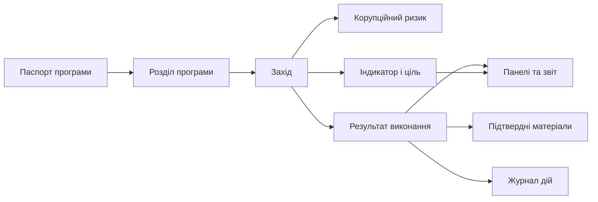

# Архітектура Digital Anti-Corruption Monitor

Цільова архітектура охоплює планування заходів, погодження результату, оцінку зміни ризику й звітність. Код охоплює реєстр, подання результатів, версії доказів, погодження, сигнали й панелі. Піврічний звіт заплановано окремим етапом. [Реєстр](registry.md) · [Результати й погодження](workflow.md)

## Компоненти

| Компонент | Папка | Відповідальність |
| --- | --- | --- |
| Вебінтерфейс | `apps/web/` | React і Vite. Реєстр, картка результату, журнал, рольові панелі й сигнали. |
| API | `apps/api/` | Node.js 24 та Express. Перевірка доступу, реєстр, результати, докази, погодження, аудит і агрегати. |
| Локальні дані | `data/` | SQLite для записів і метаданих. Файли доказів зберігаються поряд із БД. |
| Онлайн-демо | `vercel.json`, `api/`, `supabase/migrations/` | Vercel обслуговує HTTPS-інтерфейс і API. Supabase зберігає записи в PostgreSQL, докази в приватному сховищі. |
| Робота команди | `docs/`, `.github/` | План, записи етапів і автоматичні перевірки. |

Після `npm run build` локальний Express обслуговує вебінтерфейс і `/api` на одному порту. Підготовлена збірка із залежностями працює офлайн. У хмарі Vercel віддає збірку Vite й передає `/api` функції з тим самим Express-застосунком. Доступ до схеми `dacm` має обмежена серверна роль через TLS, а докази видаються через API після перевірки прав і SHA‑256. [Повторне розгортання](deployment.md)

## Модель і наскрізний сценарій

1. Координатор створює захід із розділом, відповідальним, плановою датою та індикатором. Заходи другого розділу посилаються на ризик із реєстру. Індикатор містить одиницю, базове і цільове значення та напрям покращення.
2. Виконавець відкриває власний захід і вносить опис, фактичну дату, виміряне значення та підтвердний файл. Він подає результат на перевірку. Координатор погоджує або повертає його із зауваженням.
3. Кожна зміна має запис аудиту з виконавцем дії, часом, об’єктом і зміною. Заміна підтвердження створює нову версію. SHA-256 обчислюється на сервері при завантаженні та звіряється під час перевірки цілісності.
4. Панелі, сигнали й звіт використовують дані реєстру та погодження. Строки та Risk Flags обчислюються за датою і станом заходу. Стани погодження й сигнали строків зберігають різний зміст.

## Докази й аудит

За замовчуванням `data/demo.sqlite` містить записи, рішення та метадані, а `data/demo.sqlite.evidence` — байти файлів. За власного `DATABASE_PATH` каталог доказів утворюється додаванням `.evidence` до шляху БД. Резервна копія охоплює обидва компоненти одного стану.

Сервер додає кожну версію доказу під новим ключем. SHA-256 обчислюється з байтів файла. Пошкоджений або відсутній актуальний файл блокує погодження. Зміна стану результату, рішення й аудит записуються однією транзакцією. Для перепризначення журнал зберігає автора, час, період і попереднього та нового виконавців. [Життєвий цикл доказу й API](workflow.md)

## Доступ і панелі

Авторизація перевіряється в API для кожної дії та конкретного запису, включно із завантаженням файлів. Таблиця охоплює поточні та заплановані можливості ролей.

| Роль у системі | Що бачить і робить |
| --- | --- |
| Виконавець | Власні заходи, строки, потрібні матеріали та зауваження. Подає результат і переглядає історію. |
| Координатор програми | Реєстр і черга перевірки у межах повноважень, погодження, повернення, попередження і звіт. |
| Керівник | Прогрес, критичні заходи, контрольні строки та зміни ризиків із переходом до першоджерела. |
| Аналітик | Динаміка, виконання індикаторів і деталізація агрегатів у межах доступу. |
| Адміністратор | Демонстраційні облікові записи, ролі та довідники. Записи аудиту доступні для перегляду. |

## Risk Flags і звітність

Перші правила охоплюють прострочення, наближення строку, відсутність матеріалів, недосягнення цілі та закриття заходу без покращення індикатора. Кожен сигнал показує правило, джерельний захід і значення, що спричинили спрацювання. Рекомендована дія має пояснення. [Правила та API панелей](analytics.md)

Піврічний звіт групує заходи в три розділи за структурою завдання. Вебформа, друк, CSV і довідка використовують дані одного знімка. API застосовує однакові правила періодів і доступу на SQLite й PostgreSQL. [Звітність](reporting.md)

Для інтеграції передбачено окремий API та адаптери для імпорту довідників і синтетичних заходів, експорту звітних даних і подальшого підключення до систем МОУ та НАЗК. Межі доступу, формати обміну й джерела даних потрібно погодити перед реальною інтеграцією.

## Контракт першої ітерації

[Контракт реєстру MVP v1](registry-contract.md) описує модель даних, міграції, демосесії, матрицю доступу, API та синтетичний імпорт. [Запис етапу 1](stages/01-registry.md) фіксує перевірки реалізації.

[Контракт наскрізного сценарію](workflow-contract.md) описує результати, погодження, сигнали, панелі та звітність. Стан і передачу роботи наведено в [прогресі](PROGRESS.md).
