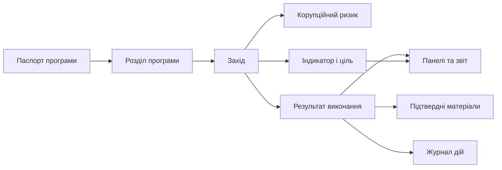

# Архітектура Digital Anti-Corruption Monitor

Цільова архітектура охоплює планування заходів, погодження результату, оцінку зміни ризику й звітність. Реалізацію поточного етапу описано у [документі реєстру](registry.md).

## Компоненти

| Компонент | Папка | Відповідальність |
| --- | --- | --- |
| Вебінтерфейс | `apps/web/` | React і Vite. Робочі кабінети, фільтри, панелі й друкована форма звіту. |
| API | `apps/api/` | Node.js 24 та Express. Перевірка доступу, сценарії роботи із заходом, аудит, аналітика, експорт. |
| База й матеріали | `data/` у локальному середовищі | SQLite для структурованих даних. Окреме сховище версій підтвердних файлів і метадані в БД. |
| Робота команди | `docs/`, `.github/` | План, записи етапів і автоматичні перевірки. |

Стартова збірка перевіряє з’єднання React → API → SQLite. Домени нижче задають архітектуру MVP. Після `npm run build` API обслуговує зібраний вебінтерфейс і запити `/api` на одному порту. Збірка потребує завантаження npm-залежностей. Запуск з підготовленою збіркою та залежностями працює локально в закритому контурі.

## Модель і наскрізний сценарій

1. Координатор створює захід із розділом, відповідальним, плановою датою та індикатором. Заходи другого розділу посилаються на ризик із реєстру. Індикатор містить одиницю, базове і цільове значення та напрям покращення.
2. Виконавець відкриває власний захід і вносить опис, фактичну дату, виміряне значення та підтвердний файл. Він подає результат на перевірку. Координатор погоджує або повертає його із зауваженням.
3. Кожна зміна має запис аудиту з виконавцем дії, часом, об’єктом і зміною. Заміна підтвердження створює нову версію. SHA-256 обчислюється на сервері при завантаженні та звіряється під час перевірки цілісності.
4. Панелі, сигнали і звіт отримують дані з тієї самої моделі. Строки та Risk Flags обчислюються за датою і станом заходу. Стани погодження й сигнали строків зберігають різний зміст.

## Доступ і панелі

Авторизація перевіряється в API для кожної дії та конкретного запису, включно з читанням файлів і експортом.

| Роль у системі | Що бачить і робить |
| --- | --- |
| Виконавець | Власні заходи, строки, потрібні матеріали та зауваження. Подає результат і переглядає історію. |
| Координатор програми | Реєстр і черга перевірки у межах повноважень, погодження, повернення, попередження і звіт. |
| Керівник | Прогрес, критичні заходи, контрольні строки та зміни ризиків із переходом до першоджерела. |
| Аналітик | Динаміка, виконання індикаторів і деталізація агрегатів у межах доступу. |
| Адміністратор | Демонстраційні облікові записи, ролі та довідники. Записи аудиту доступні для перегляду. |

## Risk Flags і звітність

Перші правила охоплюють прострочення, наближення строку, відсутність матеріалів, недосягнення цілі та закриття заходу без покращення індикатора. Кожен сигнал показує правило, джерельний захід і значення, що спричинили спрацювання. Рекомендована дія має пояснення. Уповноважена особа ухвалює рішення, зазначає відповідального та строк.

Піврічний звіт групує заходи в три розділи за структурою завдання. Для кожного рядка потрібні фактичний строк, стан і опис результату або причина невиконання. Для постійного заходу фактичний строк — 30 червня або 31 грудня відповідного року. Підтримується значення «Строк виконання не настав». Вебформа для друку й експорт використовують той самий набір записів.

Для інтеграції передбачено окремий API та адаптери для імпорту довідників і синтетичних заходів, експорту звітних даних і подальшого підключення до систем МОУ та НАЗК. Межі доступу, формати обміну й джерела даних потрібно погодити перед реальною інтеграцією.

## Контракт першої ітерації

[Контракт реєстру MVP v1](registry-contract.md) описує модель даних, міграції, демосесії, матрицю доступу, API та синтетичний імпорт. [Запис етапу 1](stages/01-registry.md) фіксує перевірки реалізації.

[Контракт наскрізного сценарію](workflow-contract.md) описує наступні етапи — результати й погодження, сигнали та панелі, звіт і довідку. Стан і передачу роботи наведено в [прогресі](PROGRESS.md).
